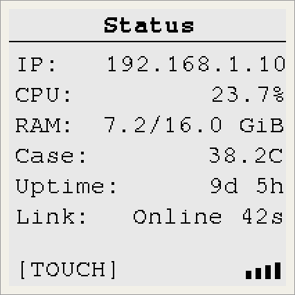
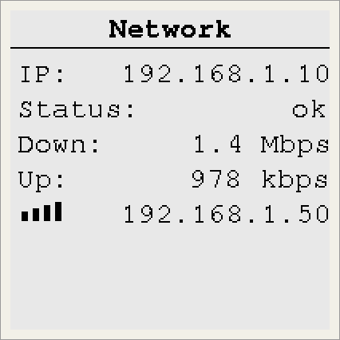
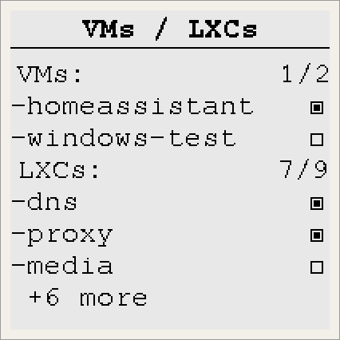
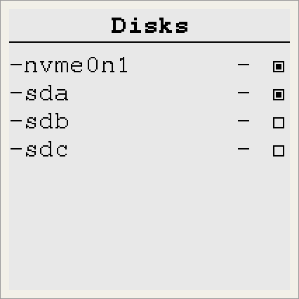
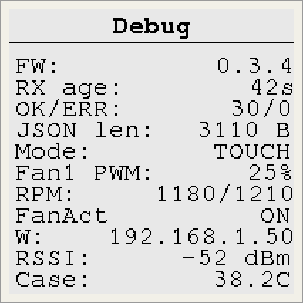
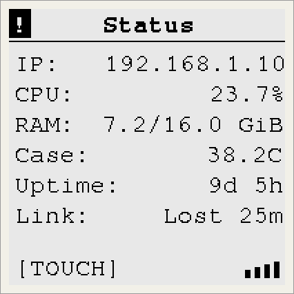
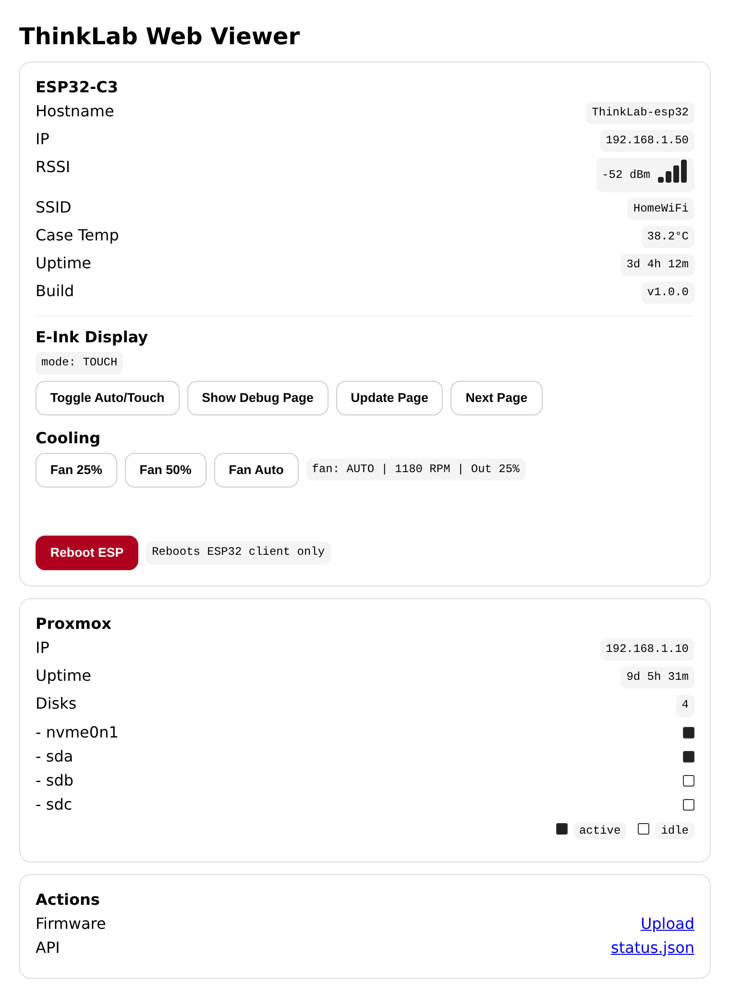

# ThinkLab ESP — e-paper status screen for a Proxmox host

[](https://github.com/Boisti13/ThinkLab-ESP/actions/workflows/checks.yml)
[](https://github.com/Boisti13/ThinkLab-ESP/tags)
[](LICENSE)

Firmware for an ESP32-C3 with a 1.54″ e-paper screen that sits on a
Proxmox host's USB port and shows how the host is doing: CPU, memory,
network, which VMs and containers run, and which disks are spinning. It
asks the host for the numbers over USB; the host side is
[ThinkLab-Host](https://github.com/Boisti13/ThinkLab-Host) (`hl-hostmon`).
A Dallas sensor adds the case temperature, and a small web page shows the
same and lets you switch pages, drive the case fan and upload new firmware.

| Status | Network | VMs / LXCs | Disks | Debug | No host data |
|---|---|---|---|---|---|
|  |  |  |  |  |  |

*Pictures rendered on a PC from the page code with made-up data
([how](#pictures)).*

## Highlights

- **Five pages**: Status (IP, CPU, RAM, case temperature, uptime, link),
  Network (rates, Wi-Fi), VMs/LXCs (running/total, running guests first),
  Disks (active or asleep), Debug
- **Always current**: asks the host every minute and redraws the page with
  each answer, with partial refresh (no flash); a black **!** in the header
  when the host hasn't answered for three minutes
- **Touch or auto**: one tap refreshes, a second tap within 20 s turns the
  page, a long press switches to automatic rotation; double tap opens Debug
- **No network needed for the screen**: data comes over USB from the host;
  Wi-Fi is only for the web page and updates
- **Robust link**: brace-framed JSON reader that ignores the board's own log
  lines; *Online/Timeout* on the Status page when the host stops answering
- **Web page**: status, page and mode buttons, fan control (25 %, 50 %,
  auto), reboot, firmware upload, `status.json`; behind a login
- **Case fan**: 4-pin PWM on a temperature curve from the Dallas sensor,
  with a start kick, smoothing, on/off hysteresis and a safe speed if the
  sensor fails;
  tachometer inputs for two fans; manual 25 %/50 % from the web page ends
  by itself after an hour or at 50 °C
- **Safe updates**: a new build is kept only once it gets Wi-Fi, otherwise
  the board goes back to the previous one by itself
- **Home Assistant**: a ready package for case temperature, fan, link and
  alerts ([below](#home-assistant))



*The web page with made-up values.*

## Hardware

| Part | Notes |
|---|---|
| ESP32-C3 board with native USB | e.g. ESP32-C3 SuperMini or DevKitM-1; the ESP32-S3 works similarly |
| 1.54″ e-paper, SSD1681, 200×200 | GxEPD2 model `GxEPD2_154_D67` |
| Touch button | TTP223 or any push button |
| DS18B20 | case temperature, 4.7 kΩ pull-up |
| 4-pin PC fan (optional) | PWM through a transistor (open collector), tach with pull-up |

| Signal | GPIO |
|---|---|
| E-paper CS / DC / RST / BUSY | 7 / 1 / 2 / 3 (SPI on the board's default pins) |
| Touch | 10 (active high; `TOUCH_ACTIVE_LOW` to flip) |
| DS18B20 (1-Wire) | 8 |
| Fan 1 PWM / tach | 9 / 5 |
| Fan 2 tach | 0 |

## Install

1. Install the host service on the Proxmox host:
   [ThinkLab-Host](https://github.com/Boisti13/ThinkLab-Host#install).
2. Build and flash the firmware with [PlatformIO](https://platformio.org):

   ```bash
   cp secrets.ini.example secrets.ini   # Wi-Fi, host name, web login, OTA address
   pio run -e esp32c3-usb -t upload     # over USB
   ```

3. Plug the board into the host. It sends `INFO` once and then `GET`
   every minute; the page redraws with each answer.

| `secrets.ini` key | Used for |
|---|---|
| `WIFI_SSID`, `WIFI_PASS` | Wi-Fi |
| `HOSTNAME` | Wi-Fi/mDNS name |
| `WEB_USER`, `WEB_PASS` | web page login; `WEB_PASS` is also the ArduinoOTA password |
| `ota_host`, `ota_pass` | the `esp32c3-ota` environment (`pio run -e esp32c3-ota -t upload`) |

**Updating** later: build and upload `.pio/build/esp32c3-usb/firmware.bin`
on the web page under *Firmware → Upload* (or `curl -u user:pass -F
update=@firmware.bin http://<board>/update`), or `pio run -e esp32c3-ota -t
upload` from a machine on the same network (ArduinoOTA connects back to the
sender, so not through a NAT or VPN gateway). A new build that doesn't get
Wi-Fi within 5 minutes is undone by the bootloader. Use a password of your
own: anyone who knows it can flash the board.

## Home Assistant

[`homeassistant/thinklab_display.yaml`](homeassistant/thinklab_display.yaml)
is a package that reads `status.json` every minute: case temperature, fan
duty and RPM, auto/manual and minutes left, Wi-Fi, uptime, firmware and
whether the board still gets host data. Scripts set the fan to 25 %, 50 %
or auto, and three automations send a message when the case stays at
50 °C, when the fan is driven but doesn't turn, or when the host stops
answering. Put the login into `secrets.yaml` (`thinklab_display_user`,
`thinklab_display_pass`), set the board's address and your notify entity,
and restart Home Assistant the first time (`rest:` loads at start-up).

## Configuration

Compile-time settings live in `platformio.ini` (`build_flags`), with
defaults in `src/config.h`:

| Setting | Default | Meaning |
|---|---|---|
| `POLL_INTERVAL_MS` | 60000 | how often to ask the host |
| `STALE_AFTER_S` | 3 polls | after this long without an answer every page shows "!" |
| `FULL_REFRESH_EVERY` | 20 | a full e-paper refresh every N redraws, partial ones in between |
| `OTA_VERIFY_TIMEOUT_MS` | 300000 | a new build must get Wi-Fi within this time or is rolled back |
| `FAN_MANUAL_MAX_MS`, `FAN_MANUAL_OVERRIDE_C` | 1 h, 50 °C | manual fan duty ends after this long or at this temperature |
| `LINK_TIMEOUT_S` | 600 | Status shows *Timeout* after this long without an answer |
| `RX_LINEBUF_BYTES` | 12288 | largest answer the reader takes |
| `JSON_DOC_BYTES` | 24576 | ArduinoJson memory for one answer (needs about 1.5× the answer's size) |
| `USE_WIFI`, `USE_DALLAS`, `USE_FAN1`, `USE_FAN2_TACH`, `USE_FANCTRL` | on | compile features in or out |
| `FC_PT1_C` … `FC_PT5_P` | see `platformio.ini` | fan curve: five points of °C → duty % |
| `DEBUG_IN_ROTATION` | 0 | Debug page in the normal rotation |

## Example

The board writes `GET` and a newline; the host answers with one line of
JSON (the full format is in
[ThinkLab-Host's README](https://github.com/Boisti13/ThinkLab-Host#example)).
The fields the pages use:

```json
{
  "schema_version": 1,
  "uptime_s": 795600,
  "cpu": {"percent": 23.7, "load1": 1.56},
  "ram": {"total_bytes": 17179869184, "used_bytes": 7730941132},
  "proxmox": {"vm_running": 1, "vm_total": 2, "lxc_running": 7, "lxc_total": 9,
              "vms": [{"id": 100, "name": "homeassistant", "status": "running"}],
              "lxcs": [{"id": 101, "name": "dns", "status": "running"}]},
  "disks": [{"name": "nvme0n1", "state": "active"}, {"name": "sdb", "state": "standby"}],
  "ip": {"primary_ipv4": "192.168.1.10/24", "ip_status": "ok"},
  "net": {"total_rx_bps": 1364680, "total_tx_bps": 977456}
}
```

Answers with another `schema_version`, or with an `error` field, are
ignored. The board keeps up to six guests of each kind, running ones first;
the VMs/LXCs page shows three VMs and four containers and counts the rest
as "+N more".

## Layout

| Path | What |
|---|---|
| `src/main.cpp` | set-up, loop, touch handling, page switching |
| `src/serial_client.*` | the USB link: polling, framing, JSON parsing into `HostState` |
| `src/pages/` | one file per e-paper page |
| `src/ui_theme.*`, `src/display_manager.*` | header, alignment and Wi-Fi icon helpers; page registry |
| `src/modules/` | Wi-Fi/OTA, web page, Dallas sensor, fan PWM, tach and control |
| `tools/render/` | renders the pages on a PC (below) |
| `docs/screenshots/` | the pictures in this README |
| `homeassistant/` | Home Assistant package |

## Development

```bash
pio run -e esp32c3-usb              # build (needs a secrets.ini; the example works)
pio device monitor                  # the board's own log, while no host service holds the port
```

The GitHub checks build the firmware with the example secrets and render
the pages.

### Fan controller on the PC

`tools/fansim/build.sh` compiles `src/modules/fanctrl.cpp` with the curve and
fan settings from `platformio.ini` and runs it through a scripted day (boot
without sensor, cool night, warm-up, the 32 °C edge, sensor lost), printing
the duty, time on, switches and start kicks for each phase. Run it after any
change to the controller.

### Pictures

`tools/render/build.sh` compiles the page code for the PC against small
stand-ins for Arduino, WiFi and GxEPD2 plus the real Adafruit GFX library,
draws every page with made-up data (`tools/render/render.cpp`) and writes
`docs/screenshots/eink-*.png`. Needs `g++`, `git` and ImageMagick. Run it
after every visible change to a page.

`tools/render/web-screenshot.js` takes the web page from a running board
(one `GET`, with `THINKLAB_WEB_USER`/`THINKLAB_WEB_PASS`), replaces every
real value with demo data, answers the page's API calls itself and saves
`docs/screenshots/web.png` (Node with Playwright; `CHROMIUM_PATH` to use an
installed browser).

See [CHANGELOG.md](CHANGELOG.md) for what changed.

## License

GPL-3.0 ([LICENSE](LICENSE)); the libraries keep their own licences
([THIRD_PARTY_NOTICES.md](THIRD_PARTY_NOTICES.md)).
